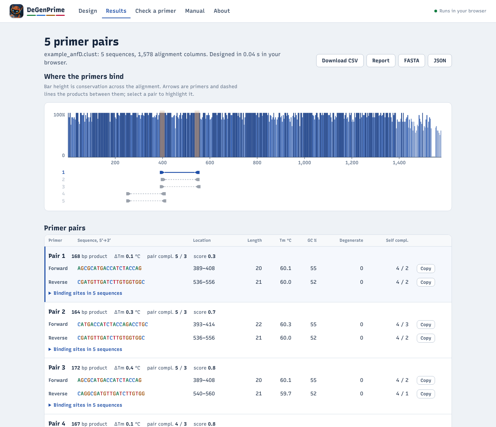

<p align="center"></p>

<h1 align="center">DeGenPrime</h1>

<p align="center"><b>Degenerate PCR primer design from DNA sequences, aligned or not.<br>One Rust crate gives you the command line, a desktop app and a website, with MAFFT built in.</b></p>

<p align="center">


</p>

Give DeGenPrime a set of related sequences (a gene family, a viral lineage, the variants of a marker gene). If they are not aligned yet, it aligns them with its built-in, pure-Rust MAFFT. It then finds conserved stretches on both strands, writes the variable positions as IUPAC codes and ranks primer pairs by conservation, then melting temperature. It reports where every primer binds in every sequence, Primer3-style dimer scores and why candidates were rejected. It can also check primers you already have.

The same engine runs three ways:

| Front end | How to start it | Engine |
|---|---|---|
| Command line | `degenprime design -i genes.fasta` | native Rust |
| Desktop app | `degenprime gui` (opens in your browser, runs on your computer) | native Rust |
| Website | Netlify static site or WordPress plugin | the same Rust, compiled to WebAssembly, in the visitor's browser |

Sequences are never uploaded anywhere, and nothing else needs installing: no MAFFT, Python or Tk.

<p align="center"></p>

---

## ✨ What's new in 2.3

| Area | Change |
|---|---|
| 🧬 MAFFT built in | Unaligned input is aligned first, in pure Rust, everywhere, including in the browser: a vendored [rust-MAFFT](https://github.com/luksgrin/rust-MAFFT) that gives the same alignments as C MAFFT. New `degenprime align`, `--align`, `--align_mode`, `--save_alignment`. See [Alignment](#-alignment-built-in-mafft). |
| 🤖 Logo and icons | The DeGenPrime robot in the app and as the icon of the Windows executable, the Start Menu, the macOS app, the Linux menu, the browser tab and the installable website. |
| 🚀 Scalable | Parallel screening, an indexed pair search and bounded memory: `--rank tm_diff` on a low-conservation 30 × 50 kb alignment went from 7.0 s to 0.24 s, a 1 Mb sequence from 12.8 s to 4.3 s, and 30 genomes of 30 kb align in 22 s using 150 MB. See [Scaling](#-scaling). |
| 🐛 Bugs fixed | `design --fasta` overwrote a `.fasta` input; fewer pairs than asked for when near-duplicates filled the pool; pair statistics that blamed the wrong rule; CLUSTAL rows with the same name merged; NaN settings accepted; Mac line endings; installer PATH problems. Details in [docs/CHANGELOG.md](docs/CHANGELOG.md). |
| 🏷️ Name | The project is just **DeGenPrime** now, at `github.com/raw-lab/degenprime`. |

Designs from aligned input are the same as in 2.2.0, byte for byte.

---

## ⚡ Quick start

### Command line and desktop app

```bash
unzip degenprime-v2.3.0.zip && cd degenprime
./install.sh                 # Linux / macOS: builds, installs to ~/.local/bin, adds a launcher
degenprime doctor            # checks the installation, the aligner included
degenprime gui               # the desktop app, in your browser
degenprime design -i data/example_anfD.clust -o anfd --detailed
```

Rust 1.75 or newer is needed (Ubuntu 24.04: `sudo apt install cargo`). Without the installer: `cargo install --path . --locked`.

**Windows:** install Rust from <https://rustup.rs>, rename `install.bat.txt` to `install.bat` (it ships as `.txt` so e-mail filters accept the zip) and run it. It adds DeGenPrime to the Start Menu and the desktop. See `WINDOWS-INSTALL.txt`.

### Website on Netlify

* **Drag and drop:** run `scripts/build_web.sh`, unzip `dist/degenprime-netlify-site-2.3.0.zip` and drop the folder on <https://app.netlify.com/drop>.
* **From GitHub:** connect the repository in Netlify; `netlify.toml` publishes `web/` as is, with no build step.

`web/_headers` sets a Content-Security-Policy that allows WebAssembly (`'wasm-unsafe-eval'`) and nothing from other origins. Visitors can install the site as an app (it has a web-app manifest and icons).

### WordPress

1. **Plugins › Add New › Upload Plugin**, choose `dist/degenprime-wordpress-plugin-2.3.0.zip`, install and activate.
2. **Tools › DeGenPrime › Create the "Primer design" page**, or put `[degenprime]` on any page.

Shortcode options: `view="design|results|check|manual|about"` and `layout="contained|wide|full"`. The app lives in a shadow root, so theme styles cannot break it.

---

## 🚀 Usage

```text
degenprime design -i <FILE> [-o <BASE>] [options]   design primer pairs (aligns unaligned input first)
degenprime align  -i <FILE> [-o <FILE>] [--mode M]  align sequences with the built-in MAFFT
degenprime test   -p <SEQ> [--partner <SEQ>]          check primers (alias: check)
degenprime gui    [--port 8737] [--no_browser]        desktop app
degenprime doctor                                     self-check
```

| Option | Default | Meaning |
|---|---|---|
| `--min_primer_len`, `--max_primer_len` | 20, 22 | primer length, 18–25 nt |
| `--min_temp`, `--max_temp` | 58, 62 | Tm window, 50–65 °C; its middle is the ranking optimum |
| `--max_tm_diff` | 5 | largest forward/reverse Tm difference, °C |
| `--min_gc`, `--max_gc`, `--max_gc_end` | 40, 60, 80 | GC %, overall and in the last five 3′ bases |
| `--amplicon`, `--max_amplicon` | 100, none | product size, bp |
| `--begin`, `--end` | whole alignment | design region, 0-based columns, end excluded |
| `--primer_conc`, `--salt_conc` | 200, 50 | nM primer, mM Na⁺ |
| `--max_primers` | 5 | pairs to return, 1–50 |
| `--max_degeneracy`, `--max_deletions` | 15, 15 | % degenerate positions / gap columns per primer |
| `--max_poly_x` | 4 | longest single-base run |
| `--max_self_any`, `--max_self_end`, `--max_pair_any`, `--max_pair_end` | 8, 3, 8, 3 | Primer3-style complementarity limits |
| `--min_3prime_distance` | 3 | skip pairs within this many bases (at both 3′ ends) of a better pair; 0 = off |
| `--rank` | `score` | `score` (conservation, then Tm) or `tm_diff` (smallest ΔTm first, the 2.1 ordering) |
| `--align` | `auto` | when to align with the built-in MAFFT: `auto` (when lengths differ), `always` (realign), `never` (pad with gaps, as 2.2 did) |
| `--align_mode` | `auto` | MAFFT strategy: `auto` (as `mafft --auto`), `fftns2`, `fftnsi`, `linsi`, `ginsi`, `einsi` |
| `--keep_strand` | off | don't reverse-complement sequences that lie on the opposite strand |
| `--save_alignment` | off | also write the alignment DeGenPrime made, `<base>.aligned.fasta` |
| `-t`, `--threads` | all cores | threads for screening and alignment; results do not depend on it |
| `--detailed`, `--fasta` | off | also write a text report / the primers as FASTA |

Values outside the documented ranges are clamped **with a warning**; values that are not numbers are refused.

### Input

FASTA (gaps as `-` or `.`), CLUSTAL from Clustal Omega, MAFFT or MUSCLE, or a single plain sequence, aligned or not. Digits, spaces and `*` are ignored, `U` reads as `T`, IUPAC codes in your sequences are respected, and protein input is refused with a message. Windows, Unix and classic Mac line endings all work.

### Output

`<base>.csv` and `<base>.json` (plus `.txt` with `--detailed`, `.fasta` with `--fasta`, `.aligned.fasta` with `--save_alignment`). The base defaults to the input's name without its extension; an output never overwrites the input (`genes.fasta` keeps its sequences and the primers go to `genes_primers.fasta`). Each row is one pair: degenerate and consensus sequences, location, length, Tm, GC, degeneracy and fold, mean conservation, self- and pair complementarity, product size and score.

Coordinates: `*_from` / `*_to` are **1-based inclusive** alignment columns on the forward strand (as on the website and in Primer3web). `forward_position` / `reverse_position` keep their 2.x meaning (0-based left-most column).

---

## 🧬 Alignment (built-in MAFFT)

Primers are designed from a multiple alignment. When the sequences have different lengths they are not aligned, and DeGenPrime aligns them first with a vendored copy of **rust-MAFFT 0.2.0** by Lucas Goiriz, a pure-Rust port of MAFFT 7.526 by Kazutaka Katoh. Because it is Rust, the same aligner runs in the command-line tool, in the desktop app and in the visitor's browser on the website. The note on the Results page (or on the terminal) says which strategy ran, and `--save_alignment` or the Results page's download gives you the alignment to inspect.

`--align_mode auto` (the default) picks the strategy the way `mafft --auto` does:

| Sequences | Longest sequence | Strategy |
|---|---|---|
| fewer than 100 | under 3,000 nt | L-INS-i (local pairwise, iterative refinement) |
| fewer than 200 | under 1,000 nt | L-INS-i, 2 refinement cycles |
| fewer than 500 | under 10,000 nt | FFT-NS-i, 2 refinement cycles |
| fewer than 20,000 | any | FFT-NS-2 (progressive, fast) |
| more | any | FFT-NS-2 with a memory-saving guide tree |

`fftns2`, `fftnsi`, `linsi`, `ginsi` (sequences alike over their whole length) and `einsi` (long unalignable insertions) choose one directly. Sequences that lie on the opposite strand to the first are reverse-complemented first, like `mafft --adjustdirection`, and DeGenPrime says which; `--keep_strand` turns that off.

**Same alignments as C MAFFT.** Compared with C MAFFT 7.525 running the same strategy (default threads), the built-in aligner gave identical alignments, column for column, on the bundled *anfD* genes and on simulated sets of 20 to 400 sequences:

| Input | Strategy | C MAFFT 7.525 | DeGenPrime | Alignment |
|---|---|---|---|---|
| *anfD* genes, 5 × 1.6 kb | L-INS-i | 0.8 s, 40 MB | 0.5 s, 80 MB | identical |
| *anfD* genes, `--align_mode fftns2` | FFT-NS-2 | 0.3 s, 23 MB | 0.1 s, 7 MB | identical |
| simulated, 20 × 1.5 kb | L-INS-i | 12.0 s, 67 MB | 11.5 s, 112 MB | identical |
| simulated, 100 × 1.5 kb | FFT-NS-i | 67.2 s, 106 MB | 54.5 s, 49 MB | identical |
| simulated, 200 × 1.5 kb | FFT-NS-i | 58.4 s, 81 MB | 51.7 s, 33 MB | identical |
| simulated, 400 × 1.0 kb | FFT-NS-i | 167 s, 206 MB | 146 s, 103 MB | identical |
| simulated, 50 × 10 kb, divergent | FFT-NS-2 | 94.8 s, 708 MB | 80.3 s, 549 MB | 99.95 % of columns identical |
| simulated, 12 × 30 kb | FFT-NS-2 | 35.8 s, 36 MB | 44.8 s, 496 MB | 99.89 % of columns identical |
| simulated, 30 × 30 kb | FFT-NS-2 | 60.8 s, 54 MB | 22.0 s, 150 MB | 99.95 % of columns identical |

Two cases can differ, by picking a different alignment of the same score: blocks of more than 150 million DP cells between FFT anchors, which DeGenPrime aligns in linear space so that memory stays bounded on the desktop and in the browser (C MAFFT keeps the full DP up to 30,000 columns), and sequences longer than 30,000 nt, where C MAFFT switches to its own memory-saving mode. In the tests above that changed 0.05 to 0.11 % of columns. Times are on a 2-core machine; DeGenPrime uses every core it is given (`-t` to limit it).

We compared two pure-Rust ports of MAFFT, rust-MAFFT and mafft-oxide; both matched C MAFFT on these tests. rust-MAFFT is the one built in because it is a library that runs the whole `mafft --auto` pipeline in process, which the WebAssembly website and a single Windows executable need; [mafft-oxide](https://github.com/Provolut/mafft-oxide) replaces MAFFT's helper programs and still runs under the `mafft` shell script. If DeGenPrime aligned your sequences, please cite MAFFT too (see [Citing](#-citing)).

---

## 🧬 How primers are chosen

1. **Consensus.** Each column becomes one position: the IUPAC code covering every base seen, the most common base and its conservation (share of sequences carrying it). Gaps count against conservation; a mostly-gap column is left out of the primer.
2. **Candidates.** Every window of the allowed lengths on both strands, inside the region (mirrored onto the reverse complement).
3. **Filters,** in order: degeneracy, gap columns, GC, 3′ GC, runs and dinucleotide repeats, complementary ends, Tm, self-complementarity. Each candidate counts under the first filter it fails.
4. **Pairing and ranking.** No overlap, product within limits, ΔTm within limit, then

   `score = Pf + Pr + |Tmf − Tmopt| + |Tmr − Tmopt| + |ΔTm|`, with `P = Σ(1 − conservation) × 100`

   so one column at 80 % conservation costs 20 points and Tm breaks ties.
5. **Final checks.** Pairs that could form a 3′ dimer are dropped; near-duplicates of a better pair are skipped. If that leaves fewer pairs than asked for, the search goes deeper.

**Tm** uses SantaLucia (1998) nearest-neighbour parameters, the salt correction 0.368·(N−1)·ln[Na⁺] and C<sub>T</sub>/4, without initiation terms, exactly as the original C++ DeGenPrime, so values remain comparable to the published tool (typically 1–3 °C from Primer3). Degenerate bases use the mean of the stacks they stand for; `test` also reports the Tm range across every variant.

---

## 📈 Scaling

Candidates are screened in parallel, straight from the consensus, with lookup tables for Tm and complementarity. The pair search never visits every forward × reverse combination: reverse primers are indexed by position, so each forward primer meets only partners that give an allowed product size, in order of cost, and the search stops as soon as no remaining partner can beat the pairs already held. The filter statistics still count every combination exactly. Results are the same whatever the number of threads.

| Design input | 2.2.0 | 2.3.0 | Same pairs |
|---|---|---|---|
| *anfD* genes, 5 × 1,578 columns | 0.02 s, 5 MB | 0.01 s, 5 MB | yes |
| 2,000 sequences × 1.5 kb | 0.07 s, 16 MB | 0.07 s, 11 MB | yes |
| 30 sequences × 50 kb | 0.13 s, 14 MB | 0.05 s, 10 MB | yes |
| 30 × 50 kb, low conservation | 0.68 s, 17 MB | 0.18 s, 16 MB | yes |
| 30 × 50 kb, low conservation, `--rank tm_diff` | 7.0 s, 17 MB | 0.24 s, 16 MB | yes |
| one sequence, 200 kb | 2.6 s, 36 MB | 0.70 s, 35 MB | yes |
| one sequence, 1 Mb | 12.8 s, 207 MB | 4.3 s, 167 MB | yes |
| 150 unaligned sequences × 1.5 kb (aligned with FFT-NS-i, then designed) | needed MAFFT installed | 5.0 s, 11 MB | – |

Same machine, 2 cores; peak memory is the whole process.

---

## 🌐 How the pieces fit together

```text
             src/api.rs  (one JSON API: design / inspect / align / check / defaults / version)
                │
                ├── src/calculator.rs, filters.rs, thermodynamics.rs, io.rs   primer design
                └── src/msa.rs → src/mafft/   built-in MAFFT (vendored rust-MAFFT)
                │
     ┌──────────┼──────────────────────────┐
     │          │                          │
 src/main.rs  src/gui.rs                 src/wasm.rs  (C ABI, no wasm-bindgen)
 CLI          127.0.0.1 server            │
              serving web/               web/assets/degenprime.wasm
                │                          │
                └──── web/assets/degenprime.js  (one UI for all three) ────┘
                                   │
                     Netlify (web/)   ·   WordPress (wordpress/degenprime)
```

The web app is a dependency-free custom element (`<degenprime-app>`). It runs the engine in a Web Worker on the website (Cancel stops it at once) and calls the local API in the desktop app. Native and WebAssembly runs produce byte-identical results.

### Rebuilding the WebAssembly engine

After changing Rust code, rebuild the engine and repackage:

```bash
scripts/build_wasm.sh     # writes web/assets/degenprime.wasm
scripts/build_web.sh      # writes dist/ (Netlify site zip + WordPress plugin zip)
```

`build_wasm.sh` uses `rustup target add wasm32-unknown-unknown` when rustup is present. With Ubuntu's apt Rust 1.75 (no packaged wasm32 standard library) it builds one from source instead: `sudo apt install rust-src lld-17` once, and the script handles the rest without sudo, using the std lockfile shipped in `wasm/`.

### Icons

Every icon comes from `assets/logo-source.png`. `make icon` runs `scripts/make_icon.py` (Pillow) for the PNG, ICO, ICNS and web icons, then `scripts/make_windows_resource.sh` (LLVM's `llvm-rc`) for the Windows resources, which `build.rs` links into `degenprime.exe`. Building needs neither tool: the results are committed.

---

## 🧪 Development

```bash
cargo test --release        # 77 DeGenPrime tests + 165 tests of the vendored aligner
scripts/smoke_test.sh       # CLI, built-in MAFFT and desktop GUI API, end to end
make help                   # all targets (lint, format, wasm, web, icon, ...)
```

```text
degenprime/
├── Cargo.toml / Cargo.lock     one crate; features: cli, gui (default); MSRV 1.75
├── build.rs                    links the icon into degenprime.exe on Windows
├── src/                        api, calculator, filters, io, models, settings, thermodynamics,
│   │                           msa (alignment), gui (desktop server), wasm, main (CLI)
│   └── mafft/                  vendored rust-MAFFT 0.2.0, with LICENSE-MAFFT.txt
├── web/                        the website (also embedded in the desktop app)
├── wordpress/degenprime/       WordPress plugin sources
├── assets/                     logo, app icons (PNG, ICO, ICNS), Windows resources
├── scripts/                    build_wasm.sh, build_web.sh, smoke_test.sh, make_icon.py,
│                               make_windows_resource.sh
├── wasm/                       std lockfile for apt-Rust WebAssembly builds
├── data/example_anfD.clust     five anfD nitrogenase genes, MAFFT L-INS-i
├── docs/                       CHANGELOG.md, previews/
└── install.sh / install.bat.txt / WINDOWS-INSTALL.txt
```

---

## 🛠️ Troubleshooting

* **No primer pairs.** Open *Filter statistics* (or the JSON `explain` block): it shows which filter rejected most candidates, and the warning suggests what to relax.
* **The alignment looks wrong.** Download it from Results (or use `--save_alignment`) and check it. Try `--align_mode linsi` for up to a few hundred sequences, or `--align never` if your input was aligned on purpose with different lengths.
* **The website says the engine could not start.** The page's Content-Security-Policy must allow `'wasm-unsafe-eval'` (script-src) and `blob:` (worker-src). If a CDN serves plugin assets from another domain, it must send CORS headers. Optimisation plugins must not combine or delay `degenprime.js`.
* **`degenprime gui` did not open a browser.** Open the address it prints. The app stops when you close its terminal window or press Ctrl+C.
* **macOS blocks the launcher.** Right-click `~/Applications/DeGenPrime.app` › Open, or `xattr -dr com.apple.quarantine ~/Applications/DeGenPrime.app`.
* **Windows build fails mentioning `link.exe`.** Install the Visual Studio C++ Build Tools (the Rust installer offers them) and run `install.bat` again.

---

## 📄 License

Free for academic, research and other non-commercial use; commercial use needs written permission. See [LICENSE](LICENSE). Because the licence is not GPL-compatible, the WordPress plugin cannot be listed in the WordPress.org directory; install it from the zip.

The built-in aligner in `src/mafft` is rust-MAFFT by Lucas Goiriz (MIT), a port of MAFFT by Kazutaka Katoh (BSD-3-Clause). Their notices are in [src/mafft/LICENSE-MAFFT.txt](src/mafft/LICENSE-MAFFT.txt), ship with the website and plugin zips, and are shown on the app's About page.

## 📚 Citing

* Fulghum B, Tanker SH, White RA III (2024). DeGenPrime provides robust primer design and optimization unlocking the biosphere. *Bioinformatics Advances* 4(1): vbae044. <https://doi.org/10.1093/bioadv/vbae044>
* White RA III (2026). DeGenPrime: a robust, streamlined, and accurate primer design via functional programming in Rust. *bioRxiv* (preprint).
* If DeGenPrime aligned your sequences: Katoh K, Standley DM (2013). MAFFT multiple sequence alignment software version 7: improvements in performance and usability. *Molecular Biology and Evolution* 30(4): 772–780. <https://doi.org/10.1093/molbev/mst010>

## 📞 Support

Issues: <https://github.com/raw-lab/degenprime/issues> · Email: Dr. Richard Allen White III, <rwhit101@charlotte.edu> · Lab: <https://www.rawlab.org>
